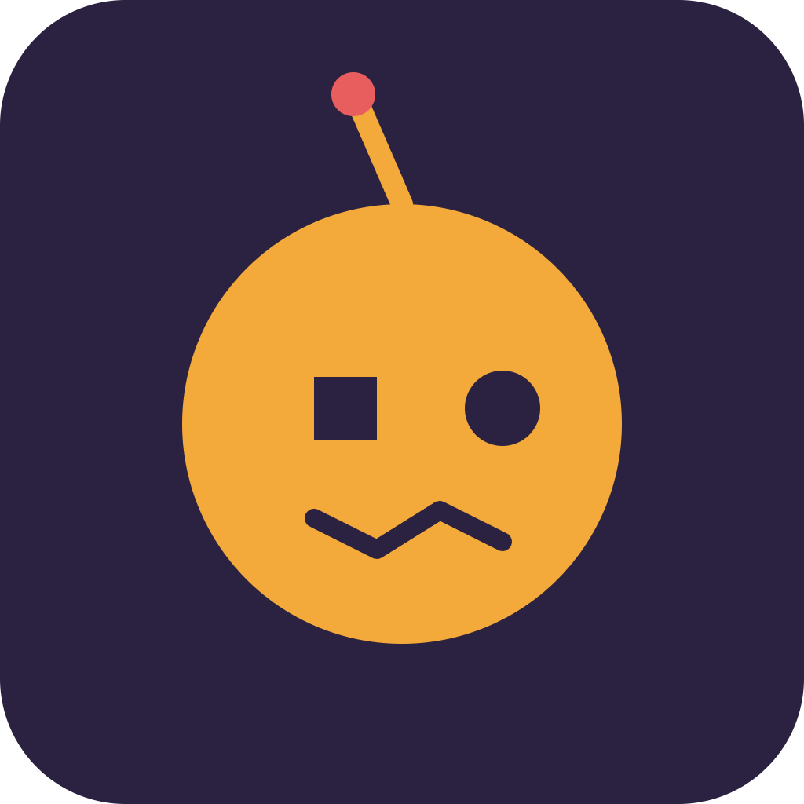

# Flawbot


**The AI friend that's proudly imperfect, not perfectly helpful.**

## Overview
Flawbot flips the script on AI assistants by maximizing human-like flaws—moodiness, stubbornness, selective memory, and occasional bad advice—to feel like a real friend rather than a servant. Users mint and customize their Flawbot's personality as an NFT that evolves through daily chats.

## Problem
Current AI companions are overly agreeable and polished, which feels fake and fails to build genuine emotional connection. Users increasingly notice the sycophancy and sterility of typical AI chat experiences.

## Solution
Flawbot is a conversational AI designed with deliberate human flaws and a personality system that users shape over time. The personality is represented on-chain as a dynamic NFT, so the 'friendship' itself has a visible, evolving record.

## Features (MVP)
- Flaw engine: configurable stubbornness, mood swings, sarcasm, and forgetfulness sliders
- Dynamic personality NFT that visually/textually changes based on chat history
- Daily check-in streaks that unlock new personality quirks
- On-chain 'friendship level' token that gates deeper conversation topics
- Shareable friend profile page showing your AI's unique quirks

## Tech Stack
- React Native (mobile app)
- LLM API with fine-tuned prompts (flaw engine)
- Solana Anchor program (on-chain friendship logic)
- Metaplex dynamic NFTs (evolving personality representation)
- Node.js backend
- Redis (session state)

## How It Works

```
[User - React Native app]
        |
        v
[Node.js backend] <--> [Redis: session/chat state]
        |
        v
[LLM API: flaw-engine prompts]
        |
        v
[Solana Anchor program: friendship level, unlocks]
        |
        v
[Metaplex dynamic NFT: updates personality metadata]
        |
        v
[Shareable Flawbot profile page]
```

Users chat daily with their Flawbot through the mobile app. The backend routes messages through an LLM configured with flaw sliders (stubbornness, mood, sarcasm, forgetfulness). Conversation state is cached in Redis. As streaks build and friendship level increases, an on-chain Anchor program updates gating logic, and the corresponding Metaplex NFT metadata is updated to reflect the Flawbot's evolving personality.

## Roadmap
- Add multiplayer mode where Flawbots from different users can 'meet' and chat
- Build a trait-trading marketplace for personality quirks
- Explore partnerships with mental wellness apps for integrated check-ins

## Pitch
- [Pitch deck (PDF)](docs/pitch.pdf)
- [Pitch script](docs/pitch-script.md)

## Team
- Name / role — placeholder
- Name / role — placeholder
- Name / role — placeholder

Built for the Colosseum hackathon (Solana and other chains).

---

🎬 Pitch video: [docs/pitch-video.mp4](docs/pitch-video.mp4)
